<div align="center">

# ZONA SFMS — Field Sales Force Management

**GPS attendance, live rep tracking, sales targets and a shareable product catalogue —<br>a Flutter app for reps and a React portal for the admin, in English and Arabic.**

[](https://github.com/abdullahwaseem-dev/field-sales-management-system/actions/workflows/ci.yml)
[](https://zona-sfms-demo.vercel.app)
[](https://github.com/abdullahwaseem-dev/field-sales-management-system/releases/latest)


[**▶ Try the live demo**](https://zona-sfms-demo.vercel.app) · [Get it for your team](#get-sfms-for-your-team) · [Screenshots](#screenshots) · [How it's built](#how-its-built)

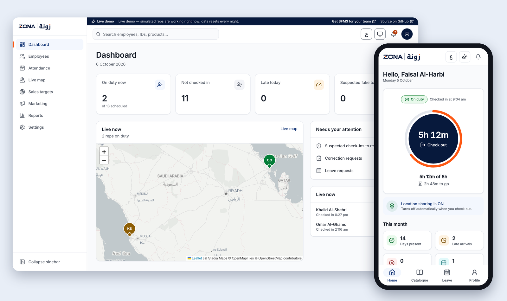

</div>

## Why SFMS

Field sales teams are hard to manage from an office: who actually showed up, where is everyone right now,
is anyone faking their location, and are we on track for this month? SFMS answers all four. It was
built for ZONA's field sales team in Saudi Arabia and is deployed for them.

- **Reps** check in with one tap. GPS, geofence and fraud checks run in the background, and the app
  shows their worked hours, their monthly target and what's left.
- **The admin** sees everyone live on a map, reviews only the check-ins that look suspicious, sets
  targets, approves leave, and closes the month with one click into Excel or the HR system.

## Try it now

| | |
|---|---|
| **Admin portal** | [zona-sfms-demo.vercel.app](https://zona-sfms-demo.vercel.app) → **Enter the demo** (admin `ZN-00001` / `ZonaDemo2026`) |
| **Android app** | [Download the demo APK](https://github.com/abdullahwaseem-dev/field-sales-management-system/releases/latest) → sign in as `DEMO-REP1` / `ZonaDemo2026` |

Eight simulated reps work staggered shifts around the clock in Riyadh, Jeddah and Dammam — checking in,
driving routes, logging visits and orders — so there is always someone on the live map. Your own
check-in from the app will be flagged *suspected* (you're not at the Riyadh office): that's the fraud
check at work, and you can review it in the portal. The demo resets every night.

## Features

**Attendance that holds up**
- One-tap GPS check-in/out, validated against circle or polygon **geofences** per branch, team or rep
- **8-hour rule**: arrive any time in a configurable window (e.g. 09:00–12:00); short days are flagged, never silently accepted
- **Fraud detection**: mock-location apps, GPS-vs-network mismatch, impossible travel speed, rooted/emulated phones — flagged as *Suspected*, never auto-confirmed; a person decides, with a remark
- Leave and correction requests, holidays, weekly off days, automatic absence marking, forgotten-checkout timeout

**Live location — only while on duty**
- Background tracking starts at check-in and stops at check-out, enforced by the database itself
- Live map with clustering and today's route per rep; offline outbox on the phone, so no point is lost in a dead zone
- Explicit, versioned consent; location history kept 12 months, then deleted automatically

**Sales targets**
- Monthly visit and order targets, set per rep or for everyone at once
- Reps log each visit and order in the app; progress bars on their home screen and in the portal; mistakes voided with a reason, never deleted

**Catalogue & marketing**
- Products, offers and promos with validity dates; reps share them on WhatsApp/SMS with a public product page
- Share tracking and reports

**Month-end in one click**
- Monthly summary per rep (present, late, absent, leave, short hours, confirmed fake), review queue, finalize/reopen with reasons
- Excel and Arabic-safe CSV export, plus a read-only **HRMS API** with API keys

**One admin, total control**
- The admin creates every account and password — there is no self-signup — and can reset any password on the spot
- Every status change has a reason and an actor; the audit log is append-only with a tamper-evident hash chain

**Built for Saudi teams**
- Full **Arabic with right-to-left layout** and English, light and dark themes, Western or Arabic-Indic digits, optional Hijri dates
- WCAG 2.2 AA contrast enforced at build time; screen-reader labels throughout

## Screenshots

| Admin dashboard | Live map with today's route |
|---|---|
| 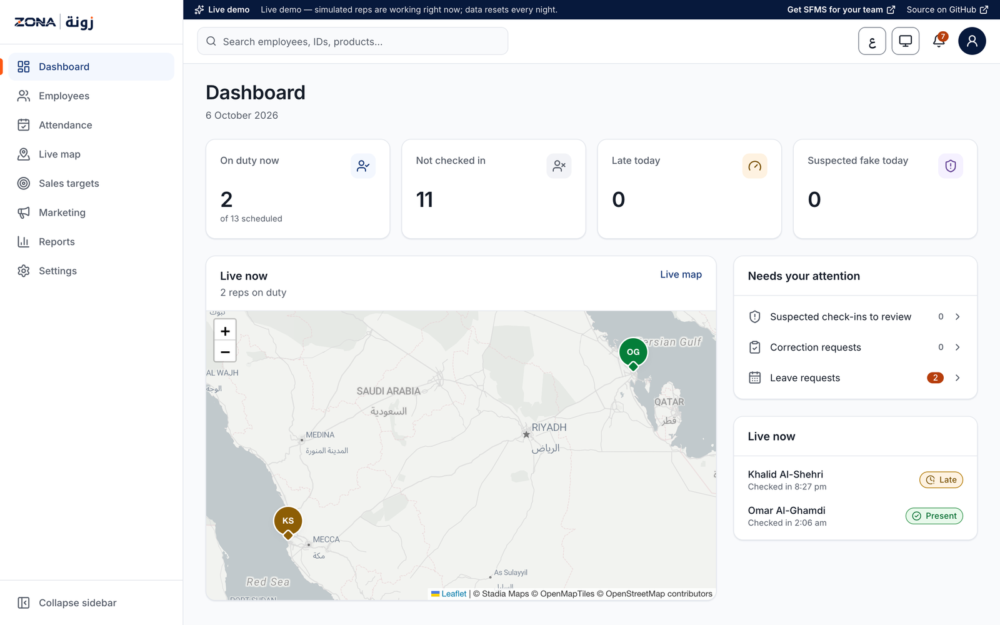 | 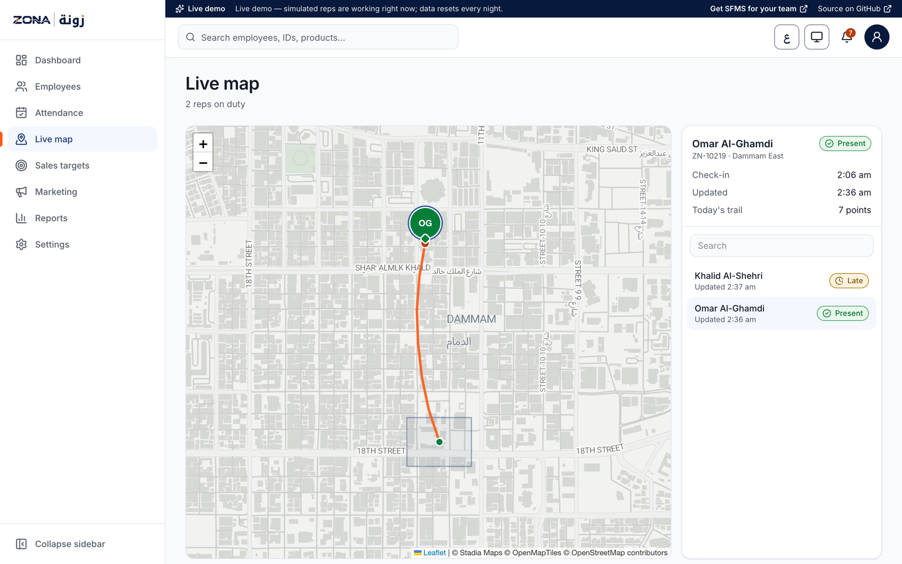 |
| **Sales targets** | **Attendance register and reviews** |
| 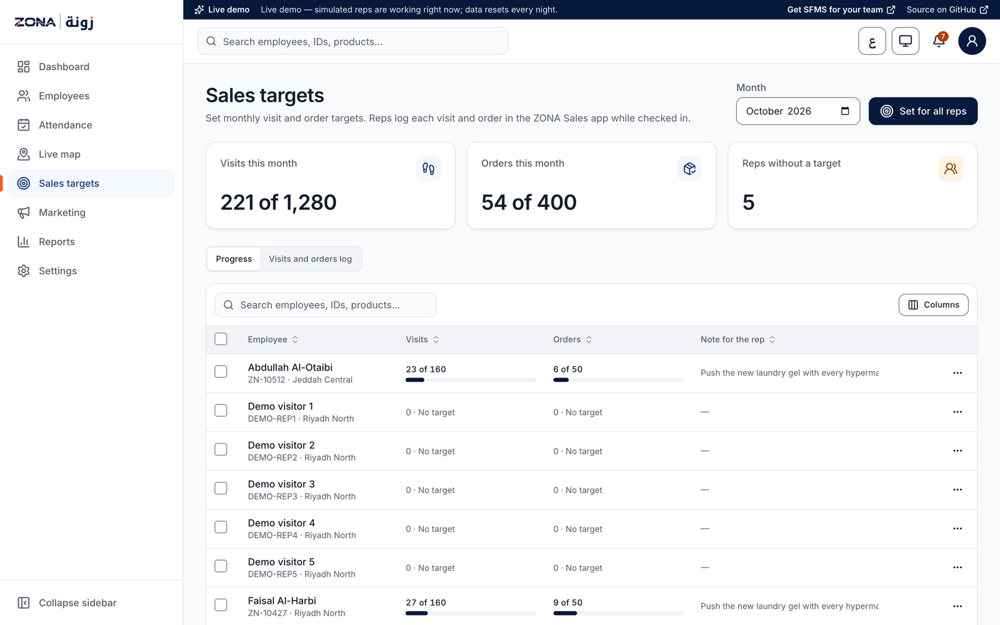 | 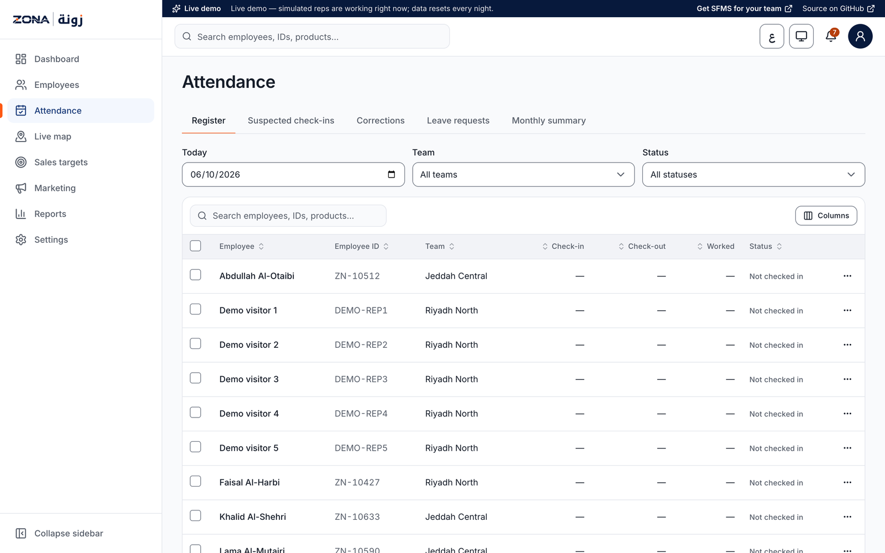 |
| **Arabic, dark theme** | **Arabic live map** |
| 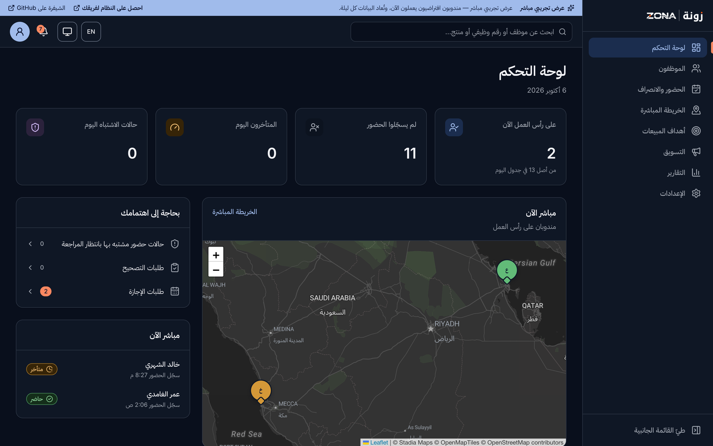 | 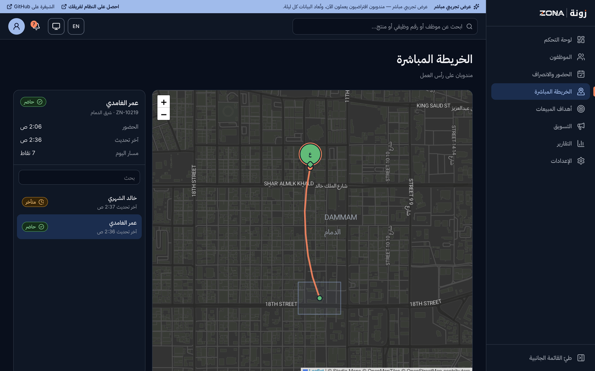 |

<p align="center">
  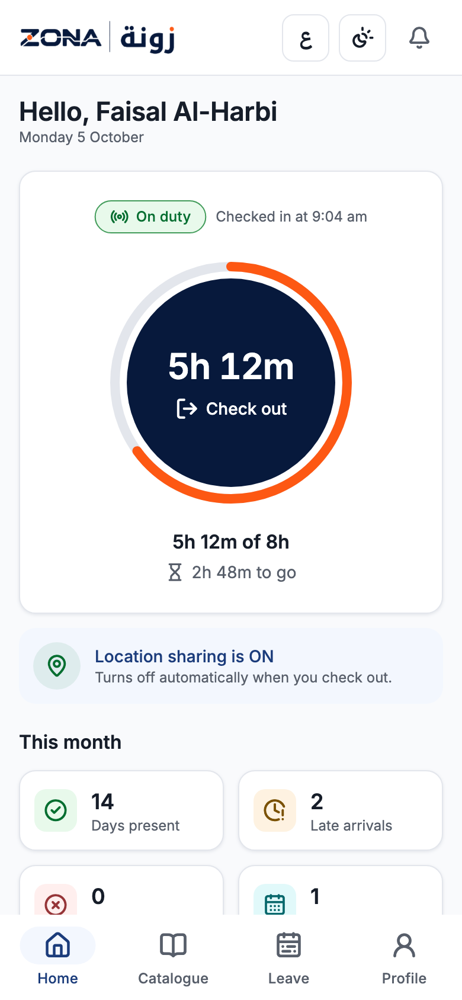
  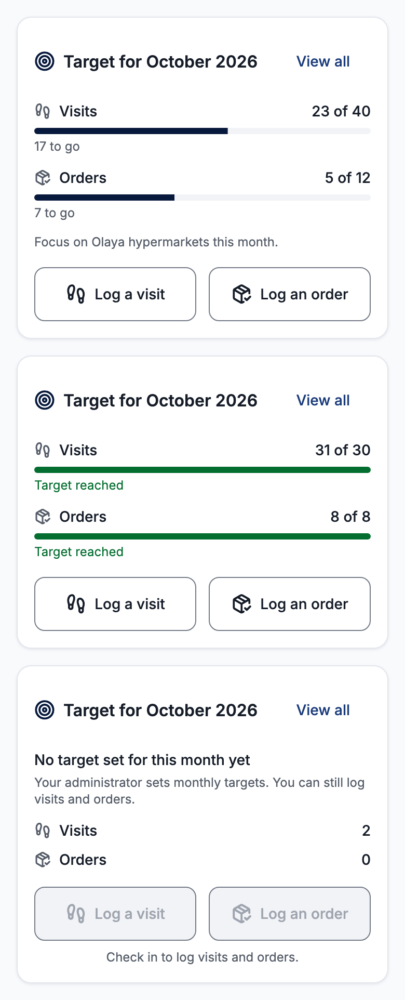
  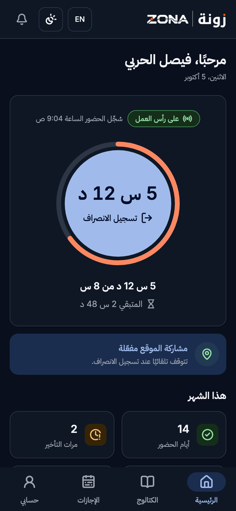
  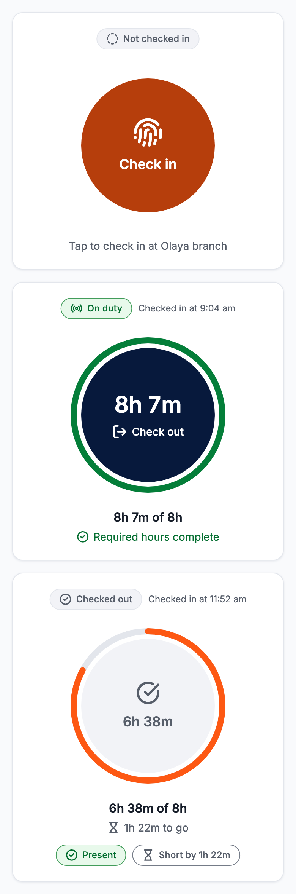
</p>

## How it's built

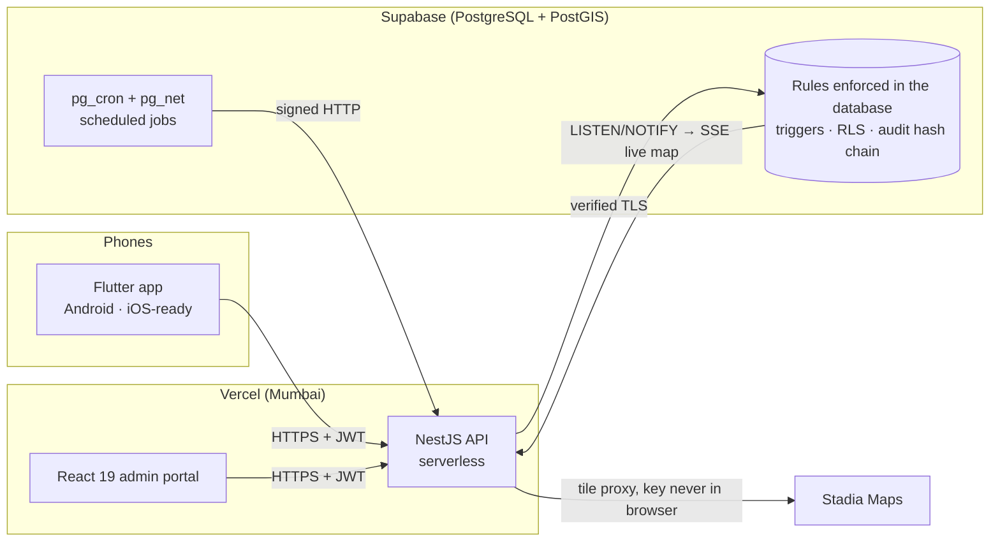

| Layer | Stack |
|---|---|
| Mobile | Flutter 3, geolocator foreground service, SQLite outbox, secure storage, device integrity checks |
| Portal | React 19, Vite, Tailwind CSS v4 (logical properties for RTL), Radix UI, TanStack Query/Table, Leaflet |
| API | NestJS 11, Kysely (typed SQL), Zod, Argon2id, rotating refresh tokens bound to one device, Server-Sent Events |
| Database | PostgreSQL 17/18 + PostGIS, dbmate migrations, monthly partitions for location pings |
| Design system | DTCG design tokens → CSS, Tailwind and Dart from one source; build fails on any WCAG AA contrast miss |
| i18n | ICU messages → portal JSON and Flutter ARB from one source; Arabic plural forms validated at build |

**Rules live in the database, not just the code.** Location pings outside a shift are rejected by a
trigger; attendance history and the audit log are append-only; every status change must declare its
cause; a finalized month is locked; there is exactly one admin account. Even a bug in the API can't
quietly rewrite history.

**Tested end to end:** 25 database-rule tests (including a full migration rollback and replay) and 30
API tests against a real PostGIS database run on every push via GitHub Actions, alongside the portal
build and Flutter static analysis; Flutter golden tests cover all four language × theme combinations.

## Run it locally

Requires Node 24, PostgreSQL 18 with PostGIS, and Flutter 3.

```bash
npm install
npm run db:start && npm run db:create      # PostgreSQL + PostGIS (Homebrew)
cp .env.example .env                       # then set JWT_SECRET (and STADIA_API_KEY for map tiles)
npm run db:migrate && npm run db:seed      # schema + sample company
npm run dev:api                            # API  → http://localhost:3000/api/v1
npm run dev:portal                         # portal → http://localhost:5173
cd apps/mobile && flutter run --dart-define=ALLOW_EMULATOR=true
```

Sample sign-ins (password `Zona@2026`): admin `ZN-00001` in the portal, rep `ZN-10427` in the app.
Put the emulator at the Riyadh branch with `adb emu geo fix 46.685 24.6935`.

| Command | What it does |
|---|---|
| `npm run db:test` | Database rule tests |
| `npm test -w @sfms/api` | API end-to-end tests |
| `npm run build:design` | Rebuild design tokens and translations (fails on contrast or ICU errors) |
| `cd apps/mobile && flutter test` | Mobile golden tests |
| `tools/demo-reset.sh` | Rebuild a demo database with three weeks of simulated activity |

<details>
<summary>Repository layout</summary>

```
apps/api           NestJS API (auth, attendance, location, sales, leave, catalogue, summary, jobs, demo simulator)
apps/portal        React admin portal
apps/mobile        Flutter rep app
packages/tokens    Design tokens → CSS vars, Tailwind theme, Dart ThemeExtensions (+ WCAG gate)
packages/i18n      English/Arabic ICU messages → portal JSON + Flutter ARB
packages/brand     Logo assets and self-hosted fonts
db/                Migrations, seeds, database rule tests
infra/             Supabase schedules, TLS root certificate
docs/              Design decisions, design-system guide, screenshots
```
</details>

## Get SFMS for your team

I build and run systems like this for companies with people in the field — sales, merchandising,
delivery, service technicians. SFMS can be set up for your company with:

- your brand, logo and colours (the whole design system is token-driven), and your languages
- your rules: shift windows, geofences, fraud thresholds, targets, approval flow
- hosting in your region, an SMS gateway for one-time codes, push notifications, Play Store / App Store release
- integration with your HR, payroll or ERP system through the HRMS API
- training, support and new features as your team grows

**Muhammad Abdullah Waseem** — full-stack & mobile developer<br>
🌐 [abdullah-waseem.vercel.app](https://abdullah-waseem.vercel.app) · ✉️ [maw112266@gmail.com](mailto:maw112266@gmail.com?subject=SFMS%20for%20our%20team)

Tell me how many people you have in the field and what you need to see — I'll reply with a plan.

## License

Source-available for evaluation only — see [LICENSE](LICENSE). You may read and run the code to
evaluate it; any production, commercial or client use needs a written license from me. The ZONA name
and logo belong to their owner and are not licensed.
